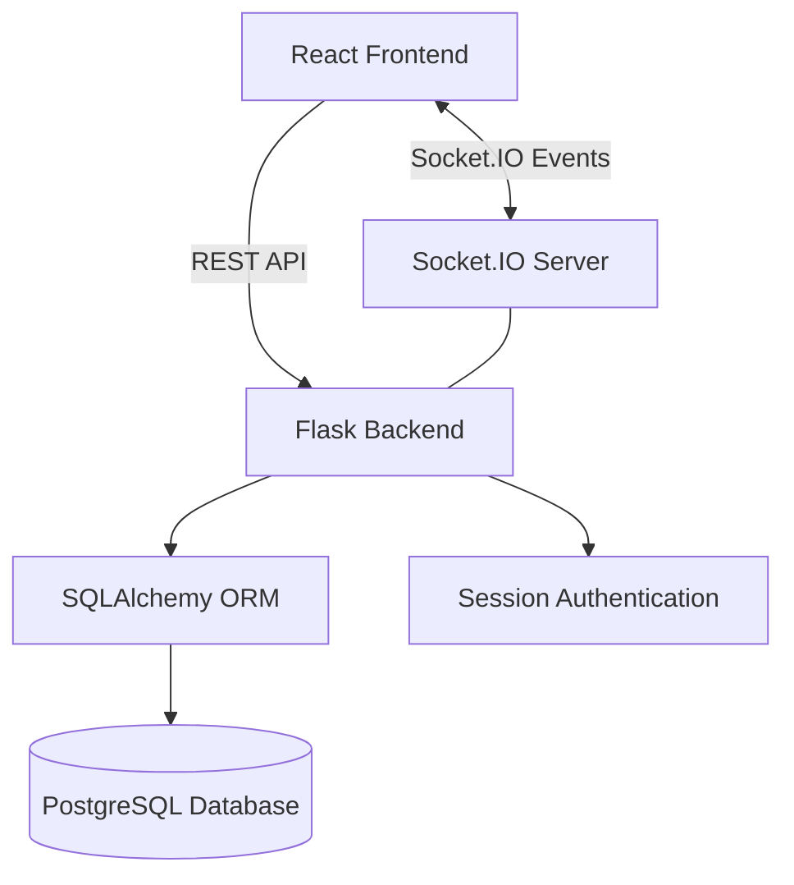

# TeamSync

### Real-Time Team Collaboration Platform

**React · Flask · PostgreSQL · Socket.IO**


TeamSync is an independently developed full-stack collaboration application that allows users to create workspaces, organize team discussions, and communicate through live messaging channels.

Built with React, Python Flask, PostgreSQL, and Socket.IO, TeamSync demonstrates RESTful API development, relational database design, session-based authentication, and event-driven communication.


## Features

### Authentication
- User registration and login
- Secure password hashing
- Session-based authentication
- Protected API endpoints
- Logout functionality

### Workspace Management
- Create and rename workspaces
- Join workspaces using invitation codes
- Switch between multiple workspaces
- Leave a workspace
- Transfer workspace ownership through the backend API
- Owner-based management permissions

### Channel Management
- Create workspace-specific channels
- Rename and delete channels
- Restrict channel management to workspace owners
- Preserve workspace separation through membership checks

### Real-Time Messaging
- Send and receive messages across authenticated accounts
- Live message updates using Socket.IO
- Edit and delete your own messages
- Broadcast message edits and deletions to connected users
- Persist message history in PostgreSQL
- Restore previously selected workspace and channel

### Interface
- Responsive React interface
- Custom teal-and-ivory design system
- Workspace and channel navigation
- Message timestamps and user identification
- Connection status indicators

## Technology Stack

| Layer | Technologies |
|---|---|
| Frontend | React, Vite, JavaScript, CSS |
| UI Icons | Lucide React |
| Backend | Python, Flask |
| Database | PostgreSQL 18 |
| ORM | SQLAlchemy |
| Authentication | Flask-Login, Werkzeug |
| Real-time communication | Flask-SocketIO, Socket.IO Client |
| Database driver | Psycopg |
| Development tools | Git, GitHub, VS Code, DataGrip |

## System Architecture



The React frontend communicates with Flask through REST endpoints. Flask handles authentication, workspace permissions, and database operations. Socket.IO distributes live message events to connected users in their respective channels.

## Database Design

TeamSync uses five core relational tables:

| Table | Purpose |
|---|---|
| users | User accounts and password hashes |
| workspaces | Workspace details, ownership, and invitation codes |
| workspace_members | User membership and roles |
| channels | Workspace-specific conversation channels |
| messages | Message content, authors, channels, and timestamps |

Foreign-key relationships connect users, workspaces, channels, and messages.

## Project Structure

```text
teamsync/
├── backend/
│   ├── app.py
│   ├── models.py
│   └── .env.example
├── frontend/
│   ├── public/
│   ├── src/
│   │   ├── App.jsx
│   │   ├── Auth.jsx
│   │   ├── App.css
│   │   └── index.css
│   ├── package.json
│   └── vite.config.js
├── screenshots/
├── .gitignore
└── README.md
```

## Getting Started

### Prerequisites

- Python 3.12+
- Node.js and npm
- PostgreSQL
- Git

### 1. Clone the repository

```bash
git clone https://github.com/Akshaya-Pujari/TeamSync.git
cd TeamSync
```

### 2. Set up the backend

```bash
cd backend
python3 -m venv venv
source venv/bin/activate
pip install Flask Flask-SQLAlchemy Flask-Cors Flask-Login Flask-SocketIO psycopg[binary] python-dotenv
```

### 3. Configure environment variables

Create a `.env` file inside `backend/`, using `.env.example` as a reference.

```dotenv
DB_HOST=localhost
DB_PORT=5433
DB_NAME=teamsync_db
DB_USER=your_postgres_username
DB_PASSWORD=your_postgres_password
SECRET_KEY=your_generated_secret_key
```

Create the `teamsync_db` database in PostgreSQL and initialize its schema using the project's SQLAlchemy models and database migration steps.

**Note:** Automated database migrations are not yet packaged with this repository. The existing development database includes the required workspace and authentication schema changes.

### 4. Start Flask

```bash
python app.py
```

Backend: `http://127.0.0.1:5000`

### 5. Set up the frontend

Open a second terminal:

```bash
cd frontend
npm install
npm run dev
```

Frontend: `http://localhost:5173`

### 6. Try TeamSync

Register an account, create a workspace, add a channel, and invite another user using the workspace invitation code.

Open TeamSync in two separate browser sessions to test live messaging.

## API Overview

| Method | Endpoint | Purpose |
|---|---|---|
| POST | `/api/auth/register` | Register user |
| POST | `/api/auth/login` | Authenticate user |
| POST | `/api/auth/logout` | End session |
| GET | `/api/auth/me` | Current user |
| GET/POST | `/api/workspaces` | List/create workspaces |
| PATCH | `/api/workspaces/:id` | Rename workspace |
| POST | `/api/workspaces/join` | Join with invite code |
| POST | `/api/workspaces/:id/leave` | Leave workspace |
| GET/POST | `/api/workspaces/:id/channels` | List/create channels |
| PATCH/DELETE | `/api/channels/:id` | Manage channels |
| GET/POST | `/api/channels/:id/messages` | Retrieve/send messages |
| PATCH/DELETE | `/api/messages/:id` | Edit/delete own messages |

## Development and Security

TeamSync includes session-based authentication, password hashing, workspace membership validation, and owner-restricted management endpoints.

Manual testing has covered authentication, message persistence, live message delivery, editing and deletion, and selected authorization checks.

### Current Limitations

- Local development uses Socket.IO HTTP long-polling while WebSocket transport issues are investigated.
- Automated test coverage and repeatable database migrations are planned.
- CSRF protection, rate limiting, production session settings, and broader authorization testing are required before public deployment.
- The application is currently intended for local development and portfolio demonstration.

## Future Improvements

- Automated backend and frontend testing
- Database migrations
- Threaded message replies
- Message search
- Typing indicators and presence
- Improved workspace membership administration
- Production deployment and monitoring

## Author

**Akshaya Pujari**

Computer Science · San Francisco State University

[GitHub](https://github.com/Akshaya-Pujari)


*TeamSync is an independent full-stack software development portfolio project.*
